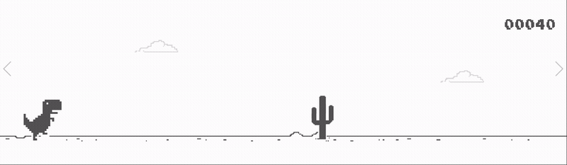

# T-Rex Game GUI Automation

**A Python bot that plays the Chrome dinosaur game using screen detection.**



## Project Structure
- `main.py` – Runs the program and automates the game.
- `images/` - Contains images used to detect the dino and the game over screen.

## Features
- Automatically starts and plays the game.
- Detects day and night mode by checking the pixels at the center of the screen, and picks the matching picture.
- Finds the dinosaur on the screen using a small saved picture of it.
- Takes a small screenshot of the area in front of the dinosaur and counts the light and dark pixels. If the less common color makes up at least 2% of the area, an obstacle is detected.
- Jumps over obstacles as soon as they enter the detection area.
- Looks further ahead every 10 seconds to adjust the detection range as the game speed increases.
- Detects when the game is over and starts a new round.

## Technologies
- Python 3.13
- PyAutoGUI
- Selenium 
- NumPy
- Pillow
- OpenCV

## Concepts Practiced
- GUI Automation
- Screen Capture and Template Matching
- Image Processing with NumPy and Pixel detection
- Browser Automation with Selenium

## Limitations
- The bot can only jump, it cannot duck.
- The game window must stay maximized and visible while the bot plays.
- The program uses screen detection to find obstacles, so its performance may vary between runs.
- Screen detection depends on the game’s position and screen layout, so changes may affect detection accuracy.

## How to Run
Install the required packages:
```bash
pip install -r requirements.txt
```
Then run the program:
```bash
python main.py
```
The bot opens the game page by itself, don't move the mouse or press any keys while it plays. To stop the program, press Ctrl+C in the terminal.